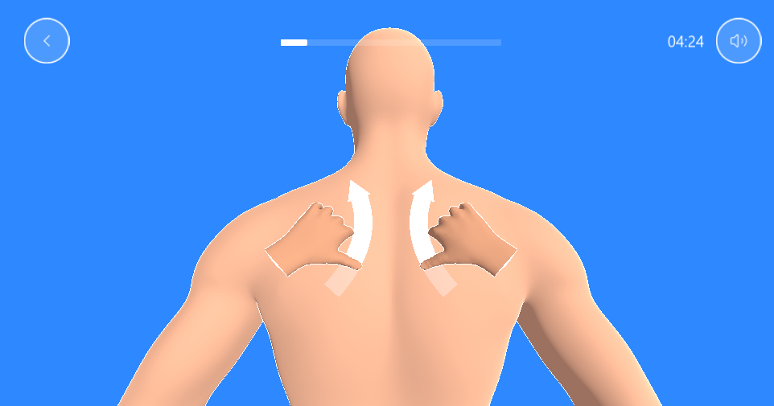
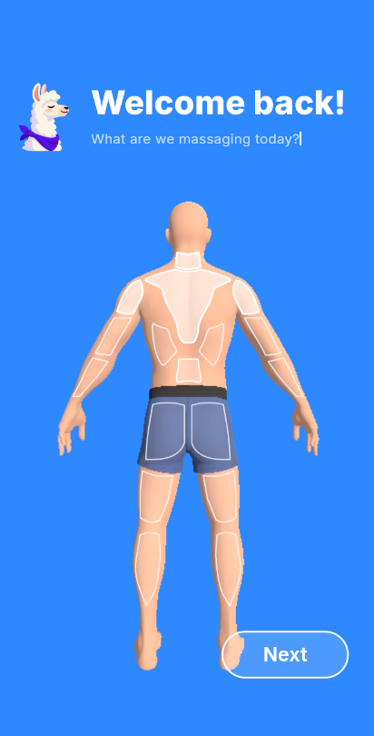
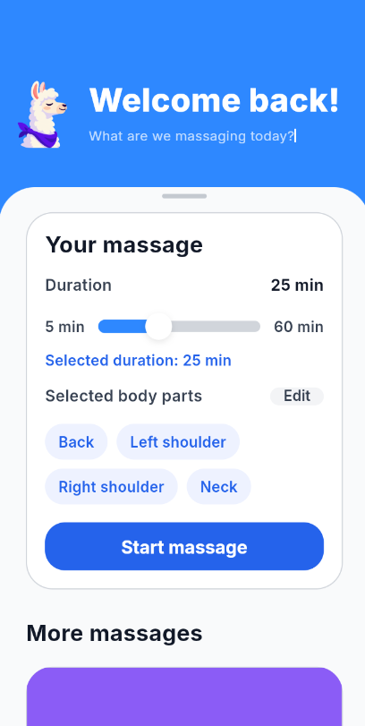
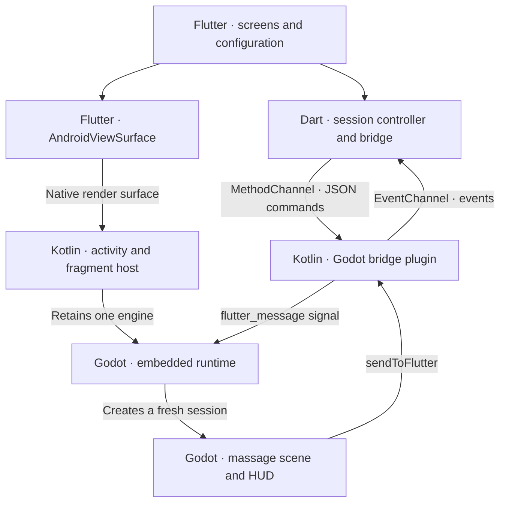

<h1 align="center">Llamassage App</h1>
<p align="center"><strong>Android / iOS</strong> · Native 3D integration currently available on Android</p>
<h2 align="center">A little less tension.<br>A whole new dimension.</h2>

<p align="center">
  <strong>Open-source 3D-guided massage.</strong><br>
  Built with Flutter &amp; Godot. Free to explore, modify, and build on.<br>
  Pick your areas. Set your time. Follow the movement.
</p>

<p align="center">
  <a href="https://github.com/kuboch17/flutter-godot-llamassageapp/actions/workflows/ci.yml"></a>
  <a href="LICENSE"></a>
  
  
</p>

<p align="center">
  <a href="#quick-start"><strong>Run it locally</strong></a> &nbsp;·&nbsp;
  <a href="#architecture"><strong>Explore the architecture</strong></a> &nbsp;·&nbsp;
  <a href="#code-map"><strong>Read the code</strong></a>
</p>

<p align="center">
  
</p>

<h2 align="center">Your session. Three simple steps.</h2>

<p align="center"><strong>① Choose your areas &nbsp; → &nbsp; ② Set 5–60 minutes &nbsp; → &nbsp; ③ Follow in 3D</strong></p>

<p align="center">
  
  &nbsp;&nbsp;
  
</p>

<p align="center">
  <strong>Animated hands.</strong> Clear movement guides. Live progress.<br>
  Portrait setup. Fullscreen landscape sessions. One app.
</p>

---

## Two engines. One experience.

**Flutter handles the interface. Godot brings the movement to life.**  
A Kotlin bridge connects them inside a single Android app.

| Flutter | Kotlin | Godot |
| --- | --- | --- |
| Body selection & session setup | Native fragment & render surface | Real-time 3D & animated hands |
| Navigation & orientation | Bidirectional JSON bridge | Spline guides & camera framing |
| Persistent app shell | Engine lifecycle | Timer, progress & sound controls |

### Built for more than a demo screen

- **Warm engine, fresh sessions.** Keep Godot loaded; create a new scene for each massage.
- **A real native surface.** Embed `GodotFragment` through Flutter's hybrid composition.
- **A small, explicit protocol.** Send commands and receive events across Dart, Kotlin, and GDScript.
- **Lifecycle-aware playback.** Pause in the background and return directly to the portrait menu.


## Architecture

### Runtime boundaries



**Flutter owns the app experience.** Home screens, selection state, configuration, navigation, and display orientation live in Dart. The Godot platform view is mounted once at the app root; the Flutter layer covers it while the menu is visible.

**Kotlin owns native integration.** The Android host manages the fragment and native surface visibility. `GodotBridgePlugin` forwards commands into a Godot signal and delivers engine events back to Dart, without interpreting massage behavior.

**Godot owns the session.** `embedded_runtime.gd` handles incoming commands and scene creation. `cube_scene.gd` owns timing, position changes, animation, camera fitting, and exit behavior. The HUD lives in Godot's `UiLayer`, so its controls remain part of the rendered session.

### Session lifecycle

1. **Preload:** Flutter mounts the native view; Godot signals readiness.
2. **Start:** the selected configuration creates a fresh session scene.
3. **Play:** Godot runs the camera entrance, movement loop, and timer.
4. **Return:** Flutter restores the portrait menu; the engine stays loaded.

### Bridge contract

Flutter sends a JSON string through the `sendMessage` method on `dev.massageflow/godot_methods`:

```json
{
  "action": "start_session",
  "payload": {
    "duration_seconds": 1500,
    "body_parts": ["Back", "Left shoulder", "Right shoulder", "Neck"]
  }
}
```

| Direction | Message | Purpose |
| --- | --- | --- |
| Flutter → Godot | `ping` | Request runtime readiness, including after a Flutter hot restart. |
| Flutter → Godot | `start_session` | Create a session using the supplied duration and body-area metadata. |
| Flutter → Godot | `stop_session` | Disable processing and hide the session HUD. |
| Flutter → Godot | `request_exit` | Ask the scene to follow its normal exit path. |
| Native host → Flutter | `engine_ready` | Signal that the native engine is available. |
| Godot → Flutter | `godot_ready` | Signal that the embedded runtime is ready for commands. |
| Godot → Flutter | `back_to_menu` | Return to Flutter navigation. |

Events arrive on `dev.massageflow/godot_events` as a platform map containing `type` and a JSON-encoded `payload` string. Dart decodes that map into a `GodotEvent`.

See [the integration guide](docs/godot-integration.md) for native lifecycle details and troubleshooting.

## Quick start

### Toolchain

These are the versions **declared by the repository**, not a claim of compatibility with every editor or SDK release.

| Dependency | Repository configuration |
| --- | --- |
| Flutter | 3.47.4 in GitHub Actions |
| Dart | `>=3.13.0 <4.0.0` in `pubspec.yaml` |
| Java | 17 |
| Android compile SDK | 36.1 |
| Android device / emulator | API 24 or newer |
| Godot Android library | `4.7.2.stable` in `android/gradle.properties` |
| Android Gradle Plugin | 9.1.0 |
| Kotlin plugin declaration | 2.4.0 |

**Check Godot version alignment before changing assets.** The source project's feature declaration currently says Godot 4.6, while the Android dependency is pinned to 4.7.2. Align the editor, imported resources, and Android library for the build you intend to test.

### Run the Android app

```sh
git clone https://github.com/kuboch17/flutter-godot-llamassageapp.git
cd flutter-godot-llamassageapp

flutter doctor
flutter pub get
flutter devices
flutter run -d <android-device-id>
```

The first build downloads the Godot Android library and its native binaries. Expect a larger initial download and APK than a Flutter-only app.

For an ARM64 debug APK:

```sh
flutter build apk --debug --target-platform android-arm64
```

Flutter selects the attached device's architecture for `flutter run`; the Gradle configuration narrows Godot's packaged ABIs when a target platform is supplied.

### Work on the Godot scene

Open `massage-app-/project.godot` in the matching Godot editor, or use a `godot` executable available on your PATH:

```sh
godot --editor --path massage-app-
```

The standalone project starts at `main.tscn`. Android staging changes the entry point to `embedded_runtime.tscn`, leaving the source project's standalone menu intact.

To run the embedded scene without Flutter:

```sh
godot --path massage-app- res://embedded_runtime.tscn
```

Without the Flutter bridge, the runtime starts an active session directly.

### Asset import and packaging

The Android `syncGodotAssets` task copies the project to generated APK assets, places `project.godot` at the asset root, and adjusts the staged viewport and orientation settings. It excludes editor state, exports, signing files, and development tools.

**Gradle does not run Godot's import pipeline.** After changing models, textures, or SVGs, import them with the matching Godot editor and include required `.godot/imported/` resources. A PCK-based pipeline is a possible future alternative, not the current build path.

## Code map

| Location | Responsibility |
| --- | --- |
| [`lib/app.dart`](lib/app.dart) | App bootstrap, launch experience, and persistent Godot host. |
| [`lib/features/home/`](lib/features/home/) | Body selection, configuration sheet, and massage catalog UI. |
| [`lib/features/session/`](lib/features/session/) | Fullscreen route, orientation changes, and back navigation. |
| [`lib/godot/`](lib/godot/) | Platform view, typed events, channel bridge, and session controller. |
| [`android/app/src/main/kotlin/dev/massageflow/app/`](android/app/src/main/kotlin/dev/massageflow/app/) | Android activity, fragment host, and Godot plugin. |
| [`android/app/build.gradle.kts`](android/app/build.gradle.kts) | Godot dependency, asset staging, and ABI packaging. |
| [`massage-app-/embedded_runtime.gd`](massage-app-/embedded_runtime.gd) | Bridge command handling and fresh scene creation. |
| [`massage-app-/cube_scene.gd`](massage-app-/cube_scene.gd) | Session state, timing, movement switching, and camera framing. |
| [`massage-app-/massage_hands_controller.gd`](massage-app-/massage_hands_controller.gd) | Animated hand placement along movement paths. |
| [`massage-app-/procedural_spline_mesh.gd`](massage-app-/procedural_spline_mesh.gd) | Procedural spline geometry. |
| [`massage-app-/session_hud.gd`](massage-app-/session_hud.gd) | Progress, remaining time, back, and sound controls. |
| [`massage-app-/assets/session/`](massage-app-/assets/session/) | Figma-exported SVG controls and progress textures. |
| [`test/`](test/) | Dart bridge and Flutter widget tests. |

## Validation

```sh
flutter analyze --fatal-infos
flutter test
godot --headless --path massage-app- --script res://tools/verify_session.gd
```

The Flutter tests cover bridge parsing and messaging, plus home-screen and navigation behavior. The Godot verification script exercises session startup, configuration, sound toggling, timing, background pause, completion, restart, exit, and camera framing at multiple landscape aspect ratios.

[GitHub Actions](.github/workflows/ci.yml) runs Flutter analysis, tests, and an Android debug build on pushes to `main` and pull requests. Godot's session verification is currently a separate local check.

For native integration changes, also test repeated entry and exit, Android back, background/resume, and orientation transitions on a physical device. Unit tests do not exercise the native render surface.

## Implementation scope

<details>
<summary><strong>Platform support and session content</strong></summary>

- The embedded 3D renderer targets Android.
- Sessions use two authored movement positions, alternating every 30 seconds.
- Selected body areas are passed to Godot as metadata; they do not change the movement sequence.
- The Flutter package is named `massage_flow` (Massage Flow); the app is presented as Llamassage.

</details>

## Contributing

Bug reports, focused pull requests, and improvements to the 3D content are welcome.

1. Open an issue for substantial changes so the proposed behavior and scope are clear.
2. Keep changes in the layer that owns the behavior: Flutter for app UI, Kotlin for native integration, Godot for session rendering and logic.
3. Run the relevant validation commands above. Include screenshots or a short recording for visible changes.
4. For Android rendering bugs, include the device, Android version, reproduction steps, and relevant Flutter/Godot logs.
5. For asset contributions, include source files and any required attribution or license information.

Start with [open issues](https://github.com/kuboch17/flutter-godot-llamassageapp/issues), or read [the integration guide](docs/godot-integration.md) before changing the native bridge.

## License

[MIT](LICENSE) · Copyright © 2026 Massage Flow contributors.
