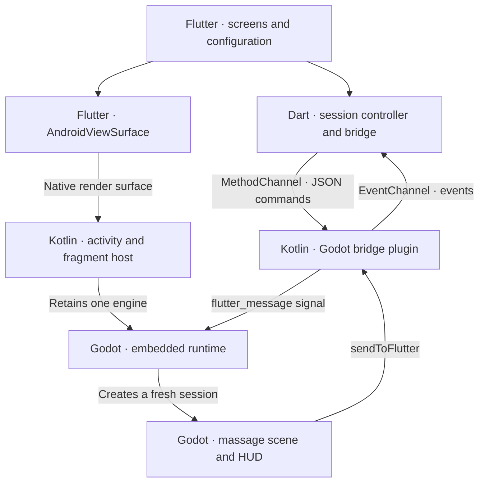

# Llamassage
### Flutter UI. Native Android bridge. Real-time 3D in Godot.

An open-source massage app exploring how a polished Flutter interface and an embedded game engine can work together in one Android application. Choose body areas, configure a session, and move into a fullscreen 3D view with animated hands, directional guides, and live session controls.

The Flutter package is named **Massage Flow** (`massage_flow`); **Llamassage** is the name shown in the launch experience.

[](https://github.com/kuboch17/flutter-godot-llamassageapp/actions/workflows/ci.yml)
[](LICENSE)


[Architecture](#architecture) · [Quick start](#quick-start) · [Code map](#code-map) · [Contributing](#contributing)

## The experience

<p align="center">
  
  &nbsp;&nbsp;
  
</p>

<p align="center"><em>Select areas → set a duration → start a 3D session.</em></p>


### What works today

- **Body-area selection:** select regions on the illustrated body, review the selection, and return to editing without losing it.
- **Session configuration:** choose a duration from 5 to 60 minutes; expandable catalog cards expose their own controls.
- **Embedded 3D:** animated hands follow spline-based movement paths over a body model, with directional guides and camera framing.
- **Session HUD:** SVG-based back and sound buttons, a progress bar, and a live remaining-time label.
- **Session lifecycle:** camera entrance, automatic start, position changes every 30 seconds, pause on backgrounding, and stop at completion.
- **Portrait-to-landscape navigation:** Flutter owns orientation and navigation; the Godot back button returns to the portrait menu.

> **Development status:** the Android integration is implemented. Body-area selections reach Godot as session metadata, but the current scene still cycles through two authored movement positions. Region-specific animation routing is not implemented yet. The embedded renderer is Android-only; the Flutter UI and standalone Godot project can be developed separately.

## Why this is interesting to build

This repository brings together application UI, native rendering, and game-engine lifecycle management:

| Engineering problem | Implementation |
| --- | --- |
| Embed a real-time renderer inside a Flutter app | `PlatformViewLink` and `AndroidViewSurface` host a native `GodotFragment` using hybrid composition. |
| Avoid restarting the engine on every navigation | One Godot view stays mounted behind the Flutter navigator. Each session instantiates a fresh scene inside the retained engine. |
| Coordinate startup across two runtimes | An `engine_ready` / `godot_ready` handshake delays session startup until the scene can receive commands. |
| Keep UI and 3D logic independent | Dart and GDScript exchange JSON envelopes through a small Kotlin bridge. |
| Keep movement guides visible across aspect ratios | Godot projects active arrow bounds and adjusts camera framing below the HUD. |
| Package source scenes with the Android app | A Gradle sync task stages the Godot project into APK assets and switches only the staged entry scene. |

## Architecture

### Runtime boundaries



**Flutter owns the app experience.** Home screens, selection state, configuration, navigation, and display orientation live in Dart. The Godot platform view is mounted once at the app root; the Flutter layer covers it while the menu is visible.

**Kotlin owns native integration.** The Android host manages the fragment and native surface visibility. `GodotBridgePlugin` forwards commands into a Godot signal and delivers engine events back to Dart, without interpreting massage behavior.

**Godot owns the session.** `embedded_runtime.gd` handles incoming commands and scene creation. `cube_scene.gd` owns timing, position changes, animation, camera fitting, and exit behavior. The HUD lives in Godot's `UiLayer`, so its controls remain part of the rendered session.

### Session lifecycle

```mermaid
sequenceDiagram
    participant F as Flutter
    participant K as Kotlin bridge
    participant G as Godot runtime
    participant S as Session scene
    F->>K: Mount platform view and subscribe
    K-->>F: engine_ready
    F->>K: ping
    K->>G: flutter_message
    G-->>K: godot_ready
    K-->>F: godot_ready
    Note over F,G: Engine and scene resources remain warm behind the menu
    F->>K: start_session(configuration)
    K->>G: flutter_message
    G->>S: Instantiate fresh scene
    S->>S: Camera entrance, timer and movement loop
    S-->>K: back_to_menu
    K-->>F: back_to_menu
    F->>K: stop_session
    K->>G: Disable session and hide HUD
    Note over F,G: Flutter restores portrait; engine remains mounted
```

### Bridge contract

Flutter sends a JSON string through the `sendMessage` method on `dev.massageflow/godot_methods`:

```json
{
  "action": "start_session",
  "payload": {
    "duration_seconds": 1500,
    "body_parts": ["Back", "Left shoulder", "Right shoulder", "Neck"]
  }
}
```

| Direction | Message | Purpose |
| --- | --- | --- |
| Flutter → Godot | `ping` | Request runtime readiness, including after a Flutter hot restart. |
| Flutter → Godot | `start_session` | Create a session using the supplied duration and body-area metadata. |
| Flutter → Godot | `stop_session` | Disable processing and hide the session HUD. |
| Flutter → Godot | `request_exit` | Ask the scene to follow its normal exit path. |
| Native host → Flutter | `engine_ready` | Signal that the native engine is available. |
| Godot → Flutter | `godot_ready` | Signal that the embedded runtime is ready for commands. |
| Godot → Flutter | `back_to_menu` | Return to Flutter navigation. |

Events arrive on `dev.massageflow/godot_events` as a platform map containing `type` and a JSON-encoded `payload` string. Dart decodes that map into a `GodotEvent`.

See [the integration guide](docs/godot-integration.md) for native lifecycle details and troubleshooting.

## Quick start

### Toolchain

These are the versions **declared by the repository**, not a claim of compatibility with every editor or SDK release.

| Dependency | Repository configuration |
| --- | --- |
| Flutter | 3.47.4 in GitHub Actions |
| Dart | `>=3.13.0 <4.0.0` in `pubspec.yaml` |
| Java | 17 |
| Android compile SDK | 36.1 |
| Android device / emulator | API 24 or newer |
| Godot Android library | `4.7.2.stable` in `android/gradle.properties` |
| Android Gradle Plugin | 9.1.0 |
| Kotlin plugin declaration | 2.4.0 |

**Check Godot version alignment before changing assets.** The source project's feature declaration currently says Godot 4.6, while the Android dependency is pinned to 4.7.2. Align the editor, imported resources, and Android library for the build you intend to test.

### Run the Android app

```sh
git clone https://github.com/kuboch17/flutter-godot-llamassageapp.git
cd flutter-godot-llamassageapp

flutter doctor
flutter pub get
flutter devices
flutter run -d <android-device-id>
```

The first build downloads the Godot Android library and its native binaries. Expect a larger initial download and APK than a Flutter-only app.

For an ARM64 debug APK:

```sh
flutter build apk --debug --target-platform android-arm64
```

Flutter selects the attached device's architecture for `flutter run`; the Gradle configuration narrows Godot's packaged ABIs when a target platform is supplied.

### Work on the Godot scene

Open `massage-app-/project.godot` in the matching Godot editor, or use a `godot` executable available on your PATH:

```sh
godot --editor --path massage-app-
```

The standalone project starts at `main.tscn`. Android staging changes the entry point to `embedded_runtime.tscn`, leaving the source project's standalone menu intact.

To run the embedded scene without Flutter:

```sh
godot --path massage-app- res://embedded_runtime.tscn
```

Without the Flutter bridge, the runtime starts an active session directly.

### Asset import and packaging

The Android `syncGodotAssets` task copies the project to generated APK assets, places `project.godot` at the asset root, and adjusts the staged viewport and orientation settings. It excludes editor state, exports, signing files, and development tools.

**Gradle does not run Godot's import pipeline.** After changing models, textures, or SVGs, import them with the matching Godot editor and include required `.godot/imported/` resources. A PCK-based pipeline is a possible future alternative, not the current build path.

## Code map

| Location | Responsibility |
| --- | --- |
| [`lib/app.dart`](lib/app.dart) | App bootstrap, launch experience, and persistent Godot host. |
| [`lib/features/home/`](lib/features/home/) | Body selection, configuration sheet, and massage catalog UI. |
| [`lib/features/session/`](lib/features/session/) | Fullscreen route, orientation changes, and back navigation. |
| [`lib/godot/`](lib/godot/) | Platform view, typed events, channel bridge, and session controller. |
| [`android/app/src/main/kotlin/dev/massageflow/app/`](android/app/src/main/kotlin/dev/massageflow/app/) | Android activity, fragment host, and Godot plugin. |
| [`android/app/build.gradle.kts`](android/app/build.gradle.kts) | Godot dependency, asset staging, and ABI packaging. |
| [`massage-app-/embedded_runtime.gd`](massage-app-/embedded_runtime.gd) | Bridge command handling and fresh scene creation. |
| [`massage-app-/cube_scene.gd`](massage-app-/cube_scene.gd) | Session state, timing, movement switching, and camera framing. |
| [`massage-app-/massage_hands_controller.gd`](massage-app-/massage_hands_controller.gd) | Animated hand placement along movement paths. |
| [`massage-app-/procedural_spline_mesh.gd`](massage-app-/procedural_spline_mesh.gd) | Procedural spline geometry. |
| [`massage-app-/session_hud.gd`](massage-app-/session_hud.gd) | Progress, remaining time, back, and sound controls. |
| [`massage-app-/assets/session/`](massage-app-/assets/session/) | Figma-exported SVG controls and progress textures. |
| [`test/`](test/) | Dart bridge and Flutter widget tests. |

## Validation

```sh
flutter analyze --fatal-infos
flutter test
godot --headless --path massage-app- --script res://tools/verify_session.gd
```

The Flutter tests cover bridge parsing and messaging, plus home-screen and navigation behavior. The Godot verification script exercises session startup, configuration, sound toggling, timing, background pause, completion, restart, exit, and camera framing at multiple landscape aspect ratios.

[GitHub Actions](.github/workflows/ci.yml) runs Flutter analysis, tests, and an Android debug build on pushes to `main` and pull requests. Godot's session verification is currently a separate local check.

For native integration changes, also test repeated entry and exit, Android back, background/resume, and orientation transitions on a physical device. Unit tests do not exercise the native render surface.

## Next development opportunities

- **Region-aware sessions:** map selected body areas to authored movement sequences.
- **More movement content:** extend the two-position scene with additional paths and transitions.
- **Toolchain alignment:** reconcile the Godot project/editor and Android library versions.
- **Device coverage:** expand validation of engine reuse, orientation, and lifecycle behavior across Android GPUs.
- **Release preparation:** replace debug release signing and validate the distributable package.
- **Additional platforms:** implement native hosts beyond Android.

These are contribution opportunities, not features already available in the app.

## Contributing

Bug reports, focused pull requests, and improvements to the 3D content are welcome.

1. Open an issue for substantial changes so the proposed behavior and scope are clear.
2. Keep changes in the layer that owns the behavior: Flutter for app UI, Kotlin for native integration, Godot for session rendering and logic.
3. Run the relevant validation commands above. Include screenshots or a short recording for visible changes.
4. For Android rendering bugs, include the device, Android version, reproduction steps, and relevant Flutter/Godot logs.
5. For asset contributions, include source files and any required attribution or license information.

Start with [open issues](https://github.com/kuboch17/flutter-godot-llamassageapp/issues), or read [the integration guide](docs/godot-integration.md) before changing the native bridge.

## License

[MIT](LICENSE) · Copyright © 2026 Massage Flow contributors.
