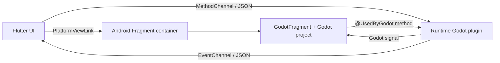

# Massage Flow — Flutter × Godot

An Android-first app in which Flutter owns the home screen and navigation while
Godot renders the massage, timer, and session controls. Godot is not launched
as a second application.

## What is implemented

- Flutter Material 3 home and a fullscreen landscape massage view. A `back`
  button inside Godot returns immediately to the portrait menu.
- Five-minute sessions that start after the camera entrance, with a blue backdrop,
  a minimal top progress bar, remaining time, and sound toggle matching the
  supplied reference. Arrow groups change every 30 seconds and remain centered
  between the progress bar and the bottom of the screen.
- An embedded `GodotFragment` exposed through a Flutter platform view using
  hybrid composition (appropriate for Godot's native render surface).
- A lifecycle-aware Kotlin host that enforces Godot's one-engine-per-process
  constraint.
- Bidirectional Flutter ↔ Kotlin ↔ Godot communication using JSON envelopes.
- The Godot project in `massage-app-`. `embedded_runtime.tscn` preloads the body
  and arrow scene behind the menu; each session creates a fresh `cube_scene.tscn`.
  Running Godot standalone still starts at `main.tscn`.
- Dart unit/widget tests and a CI workflow for analyze, test, and Android build.

## Architecture



The Android Gradle build stages `massage-app-/` as an asset source, excluding
standalone APK exports, credentials, repository data, and editor caches.
Consequently, `project.godot` is packaged at the APK asset root exactly where
the embedded engine expects it.

## Run on Android

Requirements: Flutter 3.47.x, Android SDK 36.1, Java 17, and an Android device or
emulator with API 24+.

The checked-in Android configuration is pinned to Flutter 3.47.4, Godot 4.7.2,
AGP 9.1.0, Gradle 9.3.1, and Kotlin 2.4.0.

```sh
flutter pub get
flutter analyze
flutter test
flutter run
```

The first Android build downloads the pinned Godot Android AAR and is therefore
larger and slower than a typical Flutter-only build.

Device builds package only the requested processor architecture, including
Godot's native libraries. `flutter run` selects the connected phone's
architecture automatically; for a standalone Samsung arm64 APK use
`flutter build apk --debug --target-platform android-arm64`.

## Use the real Godot project

The embedded project lives in `massage-app-/` and starts its
`embedded_runtime.tscn` scene. The build changes only the staged Android copy of
`project.godot`; the standalone Godot menu is preserved. To update it:

1. Copy the contents of the real project into `massage-app-/` so that
   `massage-app-/project.godot` remains the project root.
2. Match `godotVersion` in `android/gradle.properties` to the editor version.
3. Flutter owns orientation, fullscreen display, and navigation. The Godot
   scene's back button emits `back_to_menu` through `FlutterGodotBridge`.
   The runtime handles `start_session`, `stop_session`, and `request_exit`.
   Optional future messages can use the contract in `docs/godot-integration.md`.
4. If the project uses GDExtension or Android plugins, include their Android
   libraries for every supported ABI and add their Maven/AAR dependencies to
   `android/app/build.gradle.kts`.

Editor-only `.godot/` state and the Godot Android build template are ignored.
For direct asset embedding, commit required `.godot/imported/` artifacts as well
as source scenes, scripts, shaders, and source assets; alternatively package a
PCK in CI.

## Production notes

- Replace the sample application ID and debug release signing before shipping.
- Test navigation into and out of the Godot screen repeatedly on physical
  devices; GPU and activity lifecycle behavior varies by vendor.
- Keep one Godot platform view mounted at a time. The native host retains that
  engine across session-screen navigation and rejects multi-instance mounting.
- Godot flow tests: `godot --headless --path massage-app- --script res://tools/verify_session.gd`.
- See `docs/godot-integration.md` for the message schema, troubleshooting, and
  extension points.
